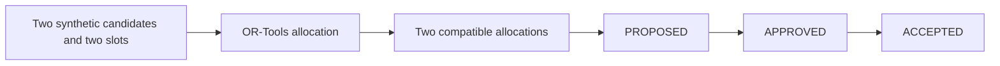

# A short synthetic OpenReadiness demo

This walkthrough shows what the prototype does today: match two synthetic
interventions to compatible manufacturing slots, then track their actions through
the first three lifecycle states. It uses local JSON fixtures and makes no calls
to partner systems or LLMs.

## Run it

Follow the [README quickstart](../README.md#quickstart) to create an environment
and install the workspace. From the repository root, run:

```bash
python simulation/timeline_emitter/run_replay.py
```

With Docker running, the equivalent one-shot replay is:

```bash
docker compose run --build --rm constraint-worker
docker compose down
```

## What happens



The checked-in [fixture](../simulation/fixtures/mock_data.json) contains:

| Candidate | Platform | Required volume | Allocated slot | Slot capacity |
| --- | --- | --- | --- | --- |
| `cand_disease_x_001` | MRNA | 2,000 L | `slot_cmo_europe_01` | 2,500 L |
| `cand_disease_x_002` | VIRAL_VECTOR | 1,000 L | `slot_cmo_asia_02` | 1,500 L |

Expected output excerpts:

```text
[T+00 Days] Ingested 2 candidate interventions from upstream R&D.
[T+06 Days] STATUS: OPTIMAL ALLOCATION FOUND (No capacity collisions detected).
  -> Candidate 'cand_disease_x_001' successfully mapped to Slot 'slot_cmo_europe_01'
  -> Candidate 'cand_disease_x_002' successfully mapped to Slot 'slot_cmo_asia_02'
Replay simulation run completed successfully.
```

Both action records pass through PROPOSED -> APPROVED -> ACCEPTED. The run then
exits; it is not a continuously running service. Simulated T+ day labels describe
scenario stages, not elapsed execution time.

## What the result means

For this fixture, each candidate has a platform-compatible AVAILABLE slot with
sufficient volume. The allocator assigns at most one candidate per slot. This is
not a complete manufacturing schedule: date windows, evidence expiry, shared
facility constraints, and cold-chain routing are not yet enforced.

Some existing console messages use words such as "audited" or "verified" as
scenario narration. All inputs are synthetic, evidence strings are placeholders,
and the run does not independently verify reservations or physical readiness.
See [implementation status](architecture.md) for the full boundaries.

## Explore a capacity conflict

The existing collision test uses two compatible candidates competing for one
slot and checks that exactly one remains unallocated:

```bash
python -m pytest services/constraint_solver/test_solver.py -q
```

Selectable replay fixtures are tracked in [issue #11](https://github.com/PAG-droid/open-readiness-tower/issues/11).

## Make a contribution

- Add allocation edge-case tests: [#6](https://github.com/PAG-droid/open-readiness-tower/issues/6) or [#7](https://github.com/PAG-droid/open-readiness-tower/issues/7).
- Check failed transitions preserve audit state: [#8](https://github.com/PAG-droid/open-readiness-tower/issues/8).
- Explain the fixture fields: [#9](https://github.com/PAG-droid/open-readiness-tower/issues/9).
- Discuss a synthetic preparedness scenario in [Ideas](https://github.com/PAG-droid/open-readiness-tower/discussions/categories/ideas).
