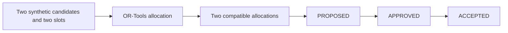

# A short synthetic OpenReadiness demo

This walkthrough shows what the prototype does today: match two synthetic
interventions to compatible manufacturing slots, then track their actions through
the first three lifecycle states. It uses local JSON fixtures and makes no calls
to partner systems or LLMs.

## Run it

Follow the [README quickstart](../README.md#quickstart) to create an environment
and install the workspace. From the repository root, run:

```bash
python simulation/timeline_emitter/run_replay.py
```

With Docker running, the equivalent one-shot replay is:

```bash
docker compose run --build --rm constraint-worker
docker compose down
```

## What happens



The checked-in [fixture](../simulation/fixtures/mock_data.json) contains:

| Candidate | Platform | Required volume | Allocated slot | Slot capacity |
| --- | --- | --- | --- | --- |
| `cand_disease_x_001` | MRNA | 2,000 L | `slot_cmo_europe_01` | 2,500 L |
| `cand_disease_x_002` | VIRAL_VECTOR | 1,000 L | `slot_cmo_asia_02` | 1,500 L |

Expected output excerpts:

```text
[T+00 Days] Ingested 2 synthetic candidate interventions.
Allocation summary: 2 allocated, 0 unallocated.
[T+06 Days] STATUS: ALL CANDIDATES ALLOCATED within the modeled constraints.
  -> Candidate 'cand_disease_x_001' successfully mapped to Slot 'slot_cmo_europe_01'
  -> Candidate 'cand_disease_x_002' successfully mapped to Slot 'slot_cmo_asia_02'
Replay simulation run completed successfully.
```

Both action records pass through PROPOSED -> APPROVED -> ACCEPTED. The run then
exits; it is not a continuously running service. Simulated T+ day labels describe
scenario stages, not elapsed execution time.

## What the result means

For this fixture, each candidate has a platform-compatible AVAILABLE slot with
sufficient volume and fresh evidence metadata at the evaluation time. The
allocator assigns at most one candidate per slot. This is not a complete
manufacturing schedule: scheduling within date windows, shared facility
constraints, and cold-chain routing are not yet enforced.

All inputs are synthetic, evidence strings are placeholders, and the run does
not independently verify reservations or physical readiness. It checks that an
expiry timestamp is later than the evaluation time, not that its evidence is true.
See [implementation status](architecture.md) for the full boundaries.

## Select a disruption scenario

```bash
python simulation/timeline_emitter/run_replay.py --fixture simulation/fixtures/capacity_shortage.json
python simulation/timeline_emitter/run_replay.py --fixture simulation/fixtures/platform_mismatch.json
python simulation/timeline_emitter/run_replay.py --as-of 2030-01-01T00:00:00Z
```

| Scenario | Allocated | Unallocated | Reason |
| --- | --- | --- | --- |
| Default `mock_data.json` | 2 | 0 | Both candidates have eligible slots |
| `capacity_shortage.json` | 1 | 1 | Two compatible candidates compete for one slot |
| `platform_mismatch.json` | 0 | 1 | The available slot supports a different platform |
| Default fixture with `--as-of 2030-01-01T00:00:00Z` | 0 | 2 | Both evidence timestamps have expired |

Do not depend on which candidate wins a capacity tie. Each valid scenario exits
zero, including those reporting a conflict. Missing or malformed files and invalid
model values exit nonzero with an error message.

## Evaluation time and validation

Included fixtures contain `evaluation_time: "2026-11-27T00:00:00Z"`. This fixed
scenario clock makes the replay reproducible, even after the evidence has expired
in real time. `--as-of` takes precedence over the fixture time. If neither exists,
the solver uses the current UTC clock.

For manufacturing windows, evidence expiry, and evaluation times, a timestamp
without an offset means UTC; other offsets are converted to UTC. Evidence expiring
exactly at the evaluation time is excluded. Dose counts and volumes must be
positive, volumes finite, and window end later than window start. Negative storage
temperatures are valid.

The tests exercise these boundaries and scenario result counts:

```bash
python -m pytest
```

## Make a contribution

- Add allocation edge-case tests: [#6](https://github.com/PAG-droid/open-readiness-tower/issues/6).
- Check failed transitions preserve audit state: [#8](https://github.com/PAG-droid/open-readiness-tower/issues/8).
- Explain the fixture fields: [#9](https://github.com/PAG-droid/open-readiness-tower/issues/9).
- Discuss a synthetic preparedness scenario in [Ideas](https://github.com/PAG-droid/open-readiness-tower/discussions/categories/ideas).
